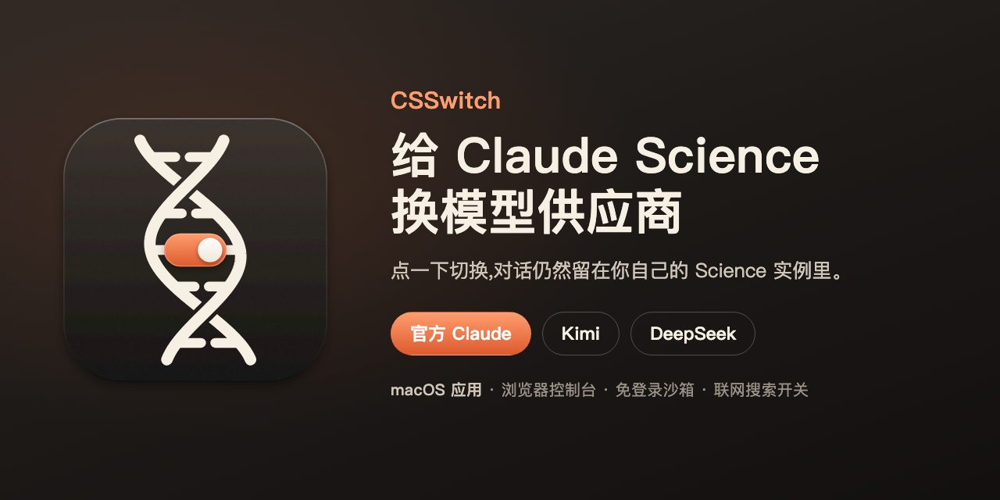

# CSSwitch



给 [Claude Science](https://claude.com) 换模型供应商的本地小工具:官方 Claude、
Kimi、DeepSeek 三选一,配置在浏览器里点,对话仍然留在你自己的 Science 实例里。

## 它是什么形态

一个本地服务进程 + 一个浏览器控制台。装成 macOS 应用后双击即可:服务在后台运行,
界面就是浏览器里的控制台。没有 Dock 图标、菜单栏图标或原生窗口;
用完在控制台点「退出服务」。

```
Claude Science(你自己的实例、你自己的登录)
        │  ANTHROPIC_BASE_URL=http://127.0.0.1:8788
        ▼
CSSwitch 服务  ── /v1/messages、/v1/models  按这个实例的模式路由
        │       ── /sandbox/v1/*            免登录沙箱的入口,按沙箱自己选的渠道路由
        │       ── /control/*               控制台后端
        │       ── /                        WebUI
        ▼
官方 api.anthropic.com  ·  Kimi  ·  DeepSeek
```

关键点:**不做数据隔离**。CSSwitch 启动的是你平时用的那个 Science
(`~/.claude-science`,真实登录),只在启动时注入:一个 base_url;关掉「联网搜索」时
再多带一份镜像配置(见下文)。CSSwitch 不往 Science 自己的目录里写任何文件。
所以历史对话、项目、MCP、Skill 全都还在原处,换供应商不会让对话分家。

## 安装与使用

### 安装版(macOS,Apple 芯片)

1. 打开 `CSSwitch-<版本>-arm64.dmg`,把 CSSwitch 拖进「应用程序」。
2. 双击 CSSwitch(或从 Launchpad / Spotlight 打开):服务在后台启动,默认浏览器打开控制台。
   服务已经在运行时,再次打开只会再开一次控制台,不会起第二个服务。
3. 在「渠道配置」里填好 base_url 与 API Key,点上方的模式卡片切换。切换会重启
   Science daemon(它只在启动时读 base_url),控制台会给出新的登录链接。
4. 用完在控制台点「退出服务」:它会先停掉 Science 与免登录沙箱,再结束后台服务。

安装版不需要 Rust、Python 或源码;Claude Science 仍然要你自己安装并登录。

**首次打开需要放行。** 应用只做了 ad-hoc 签名,没有 Apple 开发者签名,也没有公证。
经下载得到的应用首次打开时会被 macOS 拦下:到「系统设置 → 隐私与安全性」里对 CSSwitch
选择仍要打开,之后就不再提示。在本机自己构建出来的不会被拦。

几件与从终端运行不同的事:

- **日志**在 `~/.csswitch/service.log`(仅本人可读;超过 5 MiB 自动轮转,旧的一份留在
  `service.log.1`)。启动失败时会弹出提示框,里面有这条路径和日志的最后一行。
- **代理与 PATH**:从 Finder 打开的应用拿不到你在 shell 里配置的环境变量。CSSwitch 启动服务前
  会读一次登录 shell 的环境,只导入代理变量(`HTTP_PROXY` / `HTTPS_PROXY` / `ALL_PROXY` /
  `NO_PROXY` 及小写形式)、`PATH` 与 `CLAUDE_SCIENCE_BIN`,所以终端里能用的代理、本机的 `gh`
  对安装版同样生效。改了 shell 配置后,要「退出服务」再重新打开才会读到。读不到时服务照常启动,
  并在日志里写明原因。
- **升级**:先在控制台「退出服务」,再换成新版应用。后台还跑着另一个版本的服务时,
  打开应用会提示你先退出它,不会替你重启(重启会打断进行中的会话)。
- **端口**是配置文件 `~/.csswitch/service.v1.json` 里的 `port`,默认 8788。

### 从源码运行(开发入口)

```bash
./csswitch
```

首次运行会自己构建(需要 Rust 工具链),随后在前台启动服务并打开控制台,日志打在这个终端里。

```bash
./csswitch status    # 正式实例的模式、免登录沙箱的渠道与 Science 状态
./csswitch stop      # 先停掉 Science 与免登录沙箱,再停止服务(等同控制台里的「退出服务」)
```

端口默认 8788,`CSSWITCH_PORT` 可改。两种方式用同一份配置、同一个默认端口,同一时间只运行其中一个。

## 模型配置

每个渠道有四个槽:默认(均衡)、高质量、快速、Fable。
默认槽必填,其余留空自动继承默认槽。每槽可分别填上游模型 ID 与显示名——
显示名就是 Science 模型菜单里看到的名字。「获取可用模型」直接向上游要清单。

## 两个实例,各选各的

除了你自己登录的正式实例,控制台还能启动一个**免登录沙箱**:隔离的第二个 Science 实例
(`127.0.0.1:8790`,数据在 `~/.csswitch/science-sandbox/`,与正式实例的对话互不相通),
没有 Claude 订阅时也能用第三方渠道驱动 Science。两个实例各自选择用哪个 AI,互不影响:

- **正式实例**在「当前连接」卡片里选:官方 Claude / Kimi / DeepSeek。
- **免登录沙箱**在「免登录沙箱」卡片里选:Kimi / DeepSeek。

比如正式实例走官方 Claude 的同时让沙箱走 Kimi,或者两边各用一个第三方渠道。切换其中一个,
不会改动另一个的选择,也不会重启另一个。两边共用「渠道配置」里的同一份地址、API Key 与模型。

**沙箱没有「官方 Claude」这一项。** 沙箱用的是 CSSwitch 生成的虚拟登录,没有真实的 Claude 凭证,
官方接口会拒绝它;CSSwitch 也不会把你的真实登录借给沙箱。

**沙箱不向 Anthropic 上报。** 启动沙箱时,CSSwitch 用 Science 官方的 `DO_NOT_TRACK` 开关关掉它的
使用统计与错误上报。你自己登录的正式实例不受影响,仍按它自己的设置。

沙箱正在运行时切换它的渠道会先确认,确认后自动重启沙箱(沙箱里进行中的会话会被打断);
沙箱没在运行时只是保存下来,下次启动沙箱时生效。控制台的「请求日志」会标出每条请求来自
哪个实例、走了哪个渠道。

## 联网搜索开关

控制台「当前连接」卡片里有一个「联网搜索」开关,默认开启,对官方 / Kimi / DeepSeek
三种模式和免登录沙箱都生效。它对应 Claude Science 0.1.56 起的官方选项
`enable_web_search`,一个开关同时管两层:

- **Science 一侧**:关闭时,CSSwitch 把「你的 `~/.claude-science/config.toml` +
  `enable_web_search = false`」写成一份镜像(`~/.csswitch/science-config/`),启动 Science 时用
  `--config` 带上;你原有的代理、证书、镜像源等设置原样保留,Science 自己的文件不会被改动。
  开启时不带任何额外参数,完全沿用 Science 自己的配置。
- **网关一侧**:关闭时,Kimi / DeepSeek 请求里的搜索声明在入口被摘除,Kimi 的 web_search
  兼容桥不触发;保存后下一次请求即生效。

Science 只在启动时读配置,所以切换开关会重启正在运行的 Science(有会话正在进行时先确认);
免登录沙箱不会自动重启,需要手动重启后生效。这个开关只对**经 CSSwitch 启动**的 Science 生效:
你自己直接运行 `claude-science serve` 时不受它影响。

## 供应商补偿

第三方端点与官方 Anthropic API 有真实差异,直接转发会 400。补偿都是窄规则,
带规则 ID 和端点门控,日志里能看到哪条生效:

- **Kimi**:非标准 `thinking: auto` 剥离(K3 收到它会静默不思考)、
  指定型 `tool_choice` 与思考冲突时禁思考、`document` 块换署名占位文本、
  web_search 统一经 query-tool bridge 执行真实 server search、响应侧剥离搜索噪声头与
  精确幻影空搜索对、搜索对配对键采钥归一、请求侧修复历史配对,并把 Science
  尾随的机器上下文移到真实搜索问题之前。
- **DeepSeek**:`thinking auto` → `adaptive`、指定型 `tool_choice` 与思考互斥、
  thinking disabled 与 effort 互斥、带 tool_use 的历史补 thinking 块、
  畸形 server tool 块修复、孤儿工具配对按计数补齐。

补偿策略来自 provider contract,不靠环境变量传递。每条补偿的上游成因与实测证据
见 [Kimi 渠道](docs/features/kimi-channels.md) 与 [DeepSeek 渠道](docs/features/deepseek-channel.md)。

## 开发

```bash
bash test/run_all.sh          # 三层门禁:fmt+clippy / 单测 / 真实服务进程 loopback
bash packaging/build_app.sh   # 从干净的 commit 构建 dist/CSSwitch.app 与 dist/CSSwitch-<版本>-<架构>.dmg
```

构建脚本只写 `dist/`,不安装到「应用程序」;图标的重新生成见 [packaging/](packaging/README.md)。

真机验收(官方登录、真实 provider key、工具轮次)见 [test/LIVE_ACCEPTANCE.md](test/LIVE_ACCEPTANCE.md)。

架构与开发约定见 [docs/](docs/README.md);Agent 规则见 [AGENTS.md](AGENTS.md)。

## 致谢与开源协议

本项目基于 MIT 协议开源,并站在两条独立的上游工作之上。

**[SuperJJ007/CSSwitch](https://github.com/SuperJJ007/CSswitch)**(MIT)——
本仓库的直接上游。Kimi 渠道的四条兼容补偿在那里成形,包括
`thinking: auto` 让 K3 静默不思考的发现、`document` 块的署名占位方案,
以及 web_search 429 的客户端工具桥接。2026-08-19 曾尝试退役旧
`kimi_coding_search.rs` 改为原生 inline；fresh review 证明三个模型行为不一致，
2026-08-20 恢复为当前精简的 query-tool bridge。退役/恢复判据与真机证据记录在
[Kimi 渠道](docs/features/kimi-channels.md)。

**[farion1231/cc-switch](https://github.com/farion1231/cc-switch)**(MIT,© 2025 Jason Young)
及其 fork **[biociao/cc-switch](https://github.com/biociao/cc-switch)** ——
DeepSeek 官方 `/anthropic` 路线的六条 normalizer 语义来自这里
(见 biociao 为 Claude Science 提交的
[PR #6211](https://github.com/farion1231/cc-switch/pull/6211));
本仓库按自己的规则体系(规则 ID + 端点门控 + 单测)重写,并在实测后收窄了
其中过宽的判据。相关文件保留了原始版权声明。

三个仓库同为 MIT 协议,彼此兼容。若你在此基础上继续开发,请一并保留上述署名。
