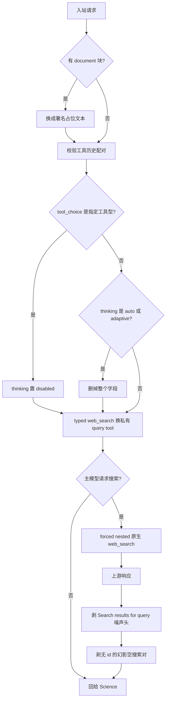

# kimi-channel 设计注记

## 原章节对照

本文与相邻几个能力的 design.md 沿用原渠道文档的小节编号（§1–§4），下表说明每一节现在在哪：

| 原小节 | 现在的位置 |
| --- | --- |
| §1 `thinking: auto` 静默不思考 | 本文 §1 |
| §2 指定工具型 `tool_choice` | 本文 §2 |
| §3 query-tool bridge、联网搜索总开关、真机验收、不提供原生直通 | [kimi-web-search-bridge](../kimi-web-search-bridge/design.md) |
| §3 搜索结果送不回历史与配对修复 | 本文 §3 |
| §3b 搜索轮的噪声头 | 本文 §3b |
| §3c 幻影空搜索对、「只发生在流式路径」 | [kimi-search-pair-adoption](../kimi-search-pair-adoption/design.md) |
| §3d 搜索对配对键采钥 | [kimi-search-pair-adoption](../kimi-search-pair-adoption/design.md) |
| §3e Science 尾随机器上下文重排 | [kimi-context-tail-reorder](../kimi-context-tail-reorder/design.md) |
| §4 `document` 内容块 | 本文 §4 |

## 背景与证据边界

Kimi 走一个 provider contract（`kimi-anthropic-relay`），默认地址
`https://api.kimi.com/coding`，可在控制台改成开放平台或其它区域端点；
模型清单由用户在四个槽里自己填，所以换端点不需要改代码。

> **证据边界**：补偿证据来自 `api.kimi.com/coding`。2026-08-20 当前 query-tool bridge
> 已分别用 K3、K3-256k、K2.7 在真实 Claude Science 搜索/追问/重载通过；开放平台和其它
> 未列模型沿用同 contract，但没有独立 live，异常必须可见失败。

端点当前提供:`kimi-for-coding`、`kimi-for-coding-highspeed`、`k3`、`k3-256k`。

核心补偿均由 `api.kimi.com/coding` 的真实 live 请求确认，各自绑定规则 ID 与单测；
Web Search bridge 另有 K3、K3-256k、K2.7 三模型的最终 Science 验收。

## 适配流程



## 1. 非标准 `thinking: {"type":"auto"}` 导致静默不思考

Claude Science 发送非标准的 `auto`。**上游不报错**,只是不思考——这正是它危险的地方:
Science 侧看不出任何异常,表现只是"这个模型怎么变笨了"。

2026-08-19 直连复测(同一问题,只改 thinking 字段,看返回的内容块):

| 模型 | 省略字段 | `auto` | `adaptive` | `enabled` |
| --- | --- | --- | --- | --- |
| `k3` | thinking+text,105 字 | **只有 text,0 字** | thinking+text,**4 字** | thinking+text,67 字 |
| `kimi-for-coding` | thinking+text,126 字 | thinking+text,104 字 | thinking+text,107 字 | thinking+text,172 字 |

缺陷**只在 K3 上**:`auto` 让它彻底不思考,`adaptive` 也几乎不思考(4 字对 105 字)。
K2.7 两种取值都正常。

补偿:删除 `auto` / `adaptive` 两个取值,交还上游默认(省略字段时 K3 正常思考)。
标准的 `enabled` / `disabled` 连同 `budget_tokens` 原样透传,effort 类字段一概不碰。
规则 `provider.kimi.thinking-upstream-default`。

**不引入** thinking 续写机制:实测该端点接受 thinking 块被剥离的历史(含带 `tool_use` 的消息),
DeepSeek 的链断裂 400 问题不适用于此渠道。

> 补充实测:删字段不等于"继承上一轮"。API 无状态,前一个请求显式 `disabled`
> 之后,下一个省略字段的请求照样思考。

## 2. 指定工具型 `tool_choice` 与默认思考冲突

`tool_choice: {"type":"tool", "name": …}` 在思考开启时返回
`400 tool_choice 'specified' is incompatible with thinking enabled`。
由于上游思考默认开启，**即使请求完全不带 `thinking` 字段也会失败**。
Science 的工作项分类器（`create_work_item`）正是这个形状，每建一个工作项触发一次。

补偿：仅当 `tool_choice.type == "tool"` 时置 `thinking: {"type":"disabled"}`，保留强制工具本身
（分类器依赖拿到结构化输出）。`any` 与 `auto` 上游无此问题，不做任何补偿。
规则 `provider.kimi.specified-tool-choice-disables-thinking`。

实测边界很窄——`auto` 与 `any` 完全正常,只有指定工具型冲突:

| tool_choice | k3 响应 |
| --- | --- |
| 不带 / `auto` / `any` | 200,`[thinking, tool_use]` |
| `{"type":"tool"}` | **400** |

## 3. 搜索结果送不回历史与配对修复

### 真正的硬缺陷:搜索结果送不回历史

关掉桥接原生透传后,第 1 轮搜索成功,第 2 轮必然
`400 tool_call_id  is not found`。逐步定位到根因,过程中推翻了两个旧说法:

| 曾经的说法 | 实测结论 |
| --- | --- |
| "两个空格说明 id 为空" | **错**。普通工具用一个非空但不匹配的 id,报错完全相同。该报错从不插入具体 id,双空格只是文案格式缺陷 |
| "结果块不携带 tool_use_id" | **错**。Kimi 发出的块携带它 |

真实骨架(诊断 `CSSWITCH_DEBUG_TOOL_SKELETON=1` 打出):

```
m3/assistant: web_search_tool_result = srvtoolu_da2nr326d89s73enoue0
m3/assistant: tool_use              = tool_lATdsqlOGD0n8Cgv
m4/user:      tool_result           = tool_lATdsqlOGD0n8Cgv
```

**同一条消息里没有任何 `server_tool_use`** —— Science 落盘时只保留了结果块,
把与之配对的请求块丢了。Kimi 的兼容层要求这一对能配上,于是拒收。

另有一种形态:两个块都在,但 Kimi 自己发出的 `server_tool_use.id`(`tool_…`)
与 `web_search_tool_result.tool_use_id`(`srvtoolu_…`)本就不是同一个值 ——
把它自己的输出原样回传,它自己拒收。

### 修复:让这一对配得上

规则 `provider.kimi.web-search-result-pairing-repair`,约六十行:

| 历史形态 | 动作 | 实测 |
| --- | --- | --- |
| 结果块孤立(无 `server_tool_use`) | 在它前面补一个同 id 的 `server_tool_use` | 400 → **200** |
| 两块都在但 id 不匹配 | 把结果块的 id 改成前面最近的 `server_tool_use.id` | 400 → **200** |
| 已经配得上 | 不动,也不记规则 | — |
| 连 `tool_use_id` 都没有,且内容为空 | 整块删除(零证据损失) | 真实会话 400 → **200** |
| 连 `tool_use_id` 都没有,但有内容 | 合成确定性配对键补上两半 | 单测锁定 |

选择补块而不是丢块:丢掉结果块同样能过(实测 200),但会丢失这一轮的搜索证据。
无 id 孤儿是上游"幻影空搜索"(见 §3c)经 Science 落盘后的产物,留着它每一轮都 400;
配对键只是相关性标记——上游自己发的两半 id 本来也对不上,合成键并不比原状更假。

## 3b. 搜索轮的噪声头(响应侧剥离)

上游对声明了原生 web_search 的轮次,会在搜索前注入一个独立 text 块,内容恒为
`Search results for query: <查询词>`,与紧随其后的 `server_tool_use.input.query`
完全重复;K2.7 还会在 turn 末尾再发一个**悬挂噪声头**(宣布下一次搜索却直接
`end_turn`,后面没有答案)——这就是第一次退役时看到的"冒号后面是空的"与
"回答为空"。三次隔离探测三发三中,形态确定。

补偿:规则 `provider.kimi.search-noise-text-strip`
(`desktop/gateway/src/kimi_search_noise.rs`),流式与非流式都把该 text 块整块剥掉。
流式实现按块缓冲到凑满前缀即拍板;被吞的块不占输出索引(Science 要求 index
连续无空洞);**未命中的流量字节级零改写**。真实 K3/K2.7 会话中每个搜索轮均命中
(日志 `noise=1`),剥后回答开头即正文。

## 4. 不接受 Anthropic `document` 内容块

上游的 Anthropic 兼容层没有实现 `document` 块。实测四种 source 形态全部失败且报文一致
（base64 `application/pdf`、`text/plain`、`url`、以及不带 source 的裸 `{"type":"document"}`），
均为 `400 invalid_request_error: "Invalid request Error"`。
决定性对照：一个**根本不存在的块类型**返回完全相同的报文 —— 说明 `document` 走的是解析器的"未知块"分支，
不是格式不匹配。

由于该块会留在对话历史里，**一个附件会让此后每一轮都失败**。真实捕获印证：同一会话 27 条消息时成功，
29 条时因某个 tool_result 轮携带了 PDF 而失败。

这个块是 Claude Science **平台 PDF 视觉通道**的载荷。真实抓包显示 `read_file(pages=[1])` 会返回
`tool_result {"status":"queued_for_vision"}`，随后追加一个 `[System] Attached file: …` 文本块，
再把 PDF 作为 `document` 块附上。

载荷是**真正的 PDF 而非渲染好的图片**：`media_type` 为 `application/pdf`，实测 134 KB，
而磁盘上的原文件是 1.28 MB / 21 页 —— 即 Science 抽取请求页另存为一个更小的 PDF 再发送。
`queued_for_vision` 描述的是意图（交给模型的视觉能力），不是传输形式；把 PDF 渲染成像素是
**模型服务商那一侧**的能力，官方 Anthropic 的 `document` 块原生支持 PDF。

所以**该平台路径在本渠道不可用，CSSwitch 也无法让它可用** —— 文件根本送不到上游，谈不上渲染。

补偿：把每个 `document` 块替换为一段署名的说明文本（注明 media type），让该轮得以继续而不是整轮失败，
并指向真正可行的路径。规则 `provider.kimi.document-block-placeholder`。

**准确地说损失了什么**：丢失的是 Science 平台侧的 PDF→视觉通道。**读 PDF 本身仍然可行** ——
Agent 可以自己把页面渲染成图像再作为 `image` 块传入，上游接受；真实会话中一份扫描版专利正是这样读到的。
这也不是 CSSwitch 相对同类渠道的倒退：DeepSeek 端点虽接受该块，但带与不带附件都回答 `CANNOT_READ`
（合成标记 PDF 与真实 133KB 专利均如此）。

占位文本必须署名。实测中模型引用了未署名的占位文本，被追问来源后**把一个正确结论当作自己编造的撤回了**；
因此文案明确标注来自 CSSwitch 网关、不是工具返回，并给出"读文件并渲染成图像"的可行替代。

`image` 块不受影响，上游可正常接受。

## 控制台

模型配置在 WebUI 的「渠道配置 → Kimi」里:base_url、API Key、四个模型槽
(默认必填,其余留空继承默认)、「获取可用模型」直接向上游拉清单。
显示名就是 Science 模型菜单里看到的名字。
