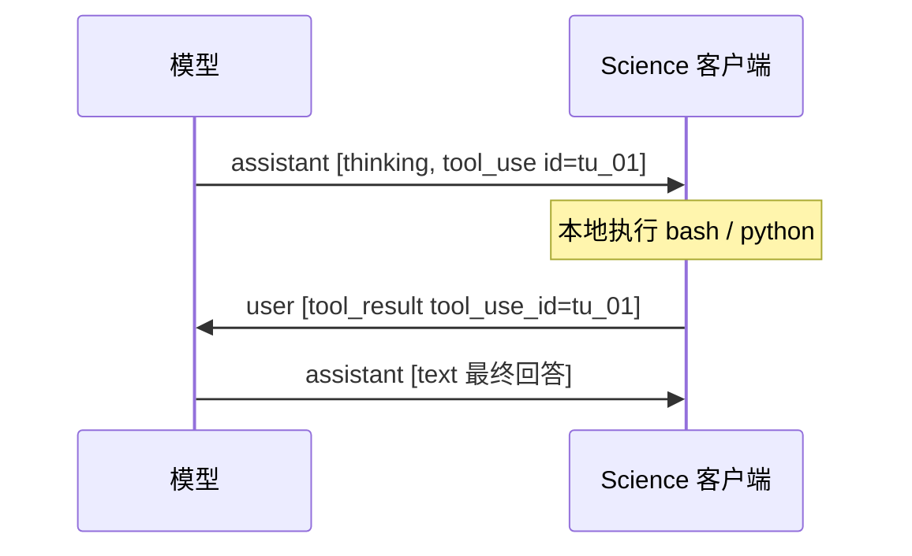
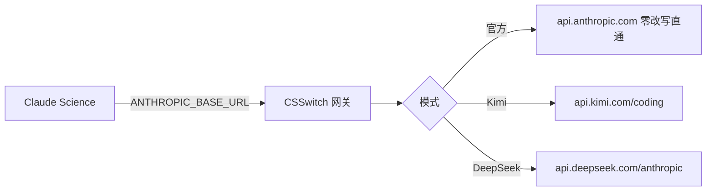

# provider-compensation 设计注记

## 理由与教训

- 复测方法见 [backend quality guidelines](../../conventions/backend/quality-guidelines.md)「判定上游是否真的不支持某能力」。
  最小成本是对上游直接发几个变体，一次对比就能定出边界。
- 策略曾经只读环境变量：契约里明明声明了策略，任何忘记注入该变量的启动路径都会**静默丢掉全部补偿**，
  表现为上游 400——而配置文件看起来完全正确。
- 规则日志记入被覆盖的改写，排查时会以为请求是以那个中间形态发出去的。
- 错误：因为"另一家这么写"就扩大判据，在能过的形态上也做补偿。

## 必需测试

- 每条补偿至少一条单测断言「拒收形态 → 归一化后形态」。
- 每条**收窄过**的判据要有一条反向测试，断言边界外的形态**不被触碰**
  （如 `only_the_specified_form_costs_thinking`）。
- 规则覆盖场景要断言被覆盖的规则**不出现**在 rule_ids 里
  （如 `specified_tool_choice_supersedes_the_auto_rewrite`）。
- 契约接线要有一条不依赖任何 env 的测试（`thinking_policy_comes_from_the_contract_without_any_env`）。

## Wrong vs Correct

### Wrong

```rust
// 照搬来源实现的宽判据,未复测边界
match body.get("tool_choice") {
    Some(Value::Object(obj)) => obj.get("type") != Some("none"),  // auto 也中招
    ...
}
```

### Correct

```rust
// 判据 == 实测出的拒收边界
body.get("tool_choice").and_then(Value::as_object)
    .and_then(|c| c.get("type")).and_then(Value::as_str) == Some("tool")
```

## 背景：Science 发出的消息长什么样

Claude Science 说的是 Anthropic Messages 协议。第三方端点自称"Anthropic 兼容",
但兼容层各有缺口。这一节与下一节讲清两件事:**Science 到底发出什么形状的消息**,
以及 **CSSwitch 在中间把哪些形状改成了上游能接受的样子**。

一次请求的 body 是一棵三层的树:

```
请求 body
├── model / max_tokens / stream
├── thinking          ← Science 发非标准的 {"type":"auto"}
├── tools[]           ← 客户端工具与服务端工具混在一起
├── tool_choice       ← 多数轮次不带;分类器调用带 {"type":"tool"}
└── messages[]        ← 完整历史,每轮都要重发一遍
    └── content[]     ← 块的数组,全部复杂度所在
```

关键认知:**API 是无状态的**。服务端不记得上一轮,`messages[]` 每次都要带上完整
历史。所以历史里任何一处结构损坏,都不是"这一轮失败",而是**此后每一轮都失败**。

### content[] 里会出现的块

| 块类型 | 谁产生 | 用途 |
| --- | --- | --- |
| `text` | 双方 | 普通文本 |
| `thinking` | 模型 | 推理过程,带 `signature` |
| `tool_use` | 模型 | 请求调用客户端工具,带 `id` |
| `tool_result` | 客户端 | 工具执行结果,带 `tool_use_id` |
| `server_tool_use` | 模型 | 请求服务端执行(如 web_search) |
| `web_search_tool_result` | **服务商** | 服务端搜索结果 |
| `image` | 客户端 | 图片 |
| `document` | 客户端 | PDF 等附件 —— **Science 的平台视觉通道** |

### 工具调用横跨两条消息



`tool_use.id` 与 `tool_result.tool_use_id` **必须一一配对**。第三方端点内部会把
消息转成 OpenAI 格式,那边的 `tool_call_id` 配对是硬约束,落单直接 400。

已知边界:客户端工具在等用户授权（如 `request_network_access`）时,Science 仍可能继续发起推理,
历史以未配对的 `tool_use` 结尾。`validate_relay_tool_history` 对所有 relay 渠道一视同仁地
拒绝这种请求,返回 `400 relay history ends with unresolved tool calls`,不会转发到上游。

服务端工具不同:它由**服务商执行**,客户端只是旁观者,两个块都落在 assistant 消息里:

```
assistant: [ server_tool_use id=srv_01 name=web_search input={query},
             web_search_tool_result tool_use_id=srv_01 content=[...] ]
```

## CSSwitch 在中间做了什么



官方模式**逐字节直通**,不做任何补偿——官方 API 就是协议本身,没有缺口可补。
第三方模式才进入补偿链。

补偿有三条铁律:

- **窄**:只改上游确实会拒收的组合,能过的原样送;
- **可见**:每条补偿有规则 ID,日志里能看到哪条生效;
- **失败显式**:补不了就把上游错误原样交回,不伪造成功。

## 补偿链

补偿都是窄规则,统一形态:端点/flavor 门控 + 规则 ID + 单测。
命中的规则会打进请求日志,便于判断"哪条在起效"。

- Kimi:`anthropic_compat.rs`(请求侧)+ `kimi_search_noise.rs`
  (搜索轮响应侧:噪声头 / 幻影对剥离、配对键采钥)
- DeepSeek:`deepseek_compat.rs`
- 策略(如 thinking 政策)来自 provider contract,不靠环境变量传递。
  环境变量只作显式 override 并留日志。
